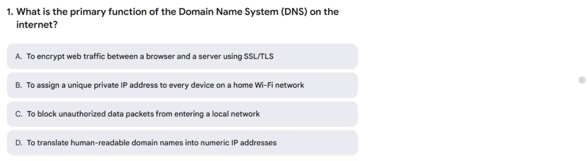
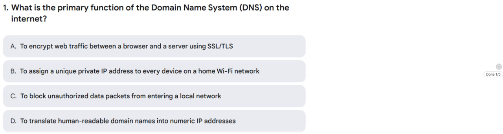
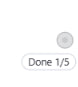
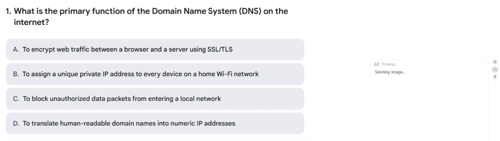
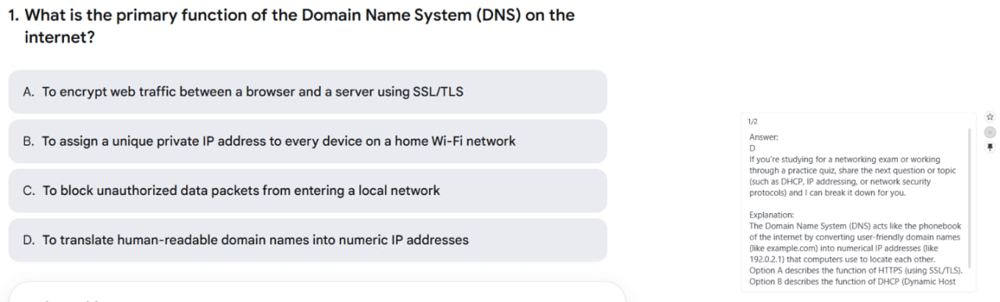
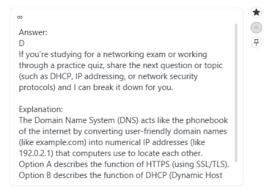
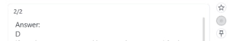

# QuickRead AI Overlay

A lightweight, stealth floating screen-snip assistant for Windows powered by Google AI Mode via a hidden Chrome session.

## Requirements

- **Windows 10 / 11**
- **Python 3.10+**
- **Git** *(or download the repository as a ZIP)*
- **Google Chrome** *(or Microsoft Edge)*

## Quick Start

```powershell
git clone https://github.com/NhaNhaa/answerBOT.git
cd answerBOT
python -m pip install -r requirements.txt
python main.py
```

*(Optional: create and activate a virtual environment first with `python -m venv .venv` and `.\.venv\Scripts\Activate.ps1`.)*

### Startup & Google Sign-In

1. The floating dot and system tray icon appear immediately on launch (clicking the dot while sign-in is pending brings Chrome to the front).
2. A Chrome window opens to Google Sign-In. Sign in once and wait ~1.5 seconds — Chrome closes automatically and restarts silently hidden in the background.
3. Your Google session is saved locally in `%LOCALAPPDATA%\QuickReadAIOverlay\chrome_profile`. On later launches, Chrome briefly opens to verify your saved session, auto-closes after ~1.5 seconds, and switches to hidden background mode without asking for your password again.

## Controls

| Control | Action |
|---|---|
| **Dot (`●`)** | Left-click to snip (`1–5` images). Drag to move (snaps to screen edges). |
| **Cancel Snip** | Quick left-click tap (`<5 px`) without dragging cancels the current snip without losing already-queued snips. |
| **`Done N/5` pill** *(below dot)* | Appears after Snip #1 (`1–4` snips). Move/scroll freely and click the dot to add more snips, click `Done N/5` to submit, or finish a 5th snip to auto-submit. |
| **Answer Box** | Translucent light-white & **100% click-through** (clicks pass straight to apps underneath). Hover over long answers and use your **scroll wheel or two-finger touchpad** to scroll. |
| **Lives (`2/2`)** *(top-left)* | Outside left-click hides the box for free. Clicking the dot toggles the same answer up to 2 times (`2/2 → 1/2 → 0/2`); the next dot click clears it and starts a new snip. |
| **Star (`☆` / `★`)** *(above dot)* | Shown while the answer box is open. Turn ON (`★`, shows `∞`) to keep the same answer across unlimited close/re-open cycles without spending lives. |
| **Pin (`📌`)** *(below dot)* | Shown while the answer box is open. Turn ON (filled) to keep the box open when clicking outside; clicking the dot still hides/re-opens it. |
| **System Tray Icon** | Right-click the tray icon to **Show / Locate Dot**, re-open **Google Login / Verify...**, or **Quit** cleanly. |

## Optional: Gemini API Mode

To use the official Gemini API instead of Chrome, set `GEMINI_API_KEY` before launching (defaults to `gemini-3.5-flash`; override with `GEMINI_MODEL` if needed):

```powershell
$env:GEMINI_API_KEY = "your-api-key"
python main.py
```

## Guideline

Run `python main.py`, sign in to your Google account in the Chrome window that opens, and wait a second until it closes into the background.

### Step 1


**Explanation:** Once you are signed in, a small grey circle appears on the edge of your screen — drag it wherever you want, or left-click it to start snipping a question.

### Step 2


**Explanation:** Drag a box over the question to capture it, and a small `Done 1/5` button pops up below the circle so you can either add up to 5 snips or click `Done` right away.

### Step 3


**Explanation:** Here is a closer look at the circle and the `Done 1/5` button underneath — click the circle again if your question needs more screenshots, or click `Done` to send what you have.

### Step 4


**Explanation:** After you click `Done`, the light see-through answer box opens beside the circle while it sends your screenshot and thinks.

### Step 5


**Explanation:** Your answer appears inside the box (hover and scroll if it is long), and clicking the Pin icon below the circle turns it solid black so the box stays open even when you click elsewhere on the screen.

### Step 6


**Explanation:** Clicking the Star icon above the circle turns it solid black and switches the top-left counter to `∞`, so this same answer stays saved no matter how many times you hide and reopen the box.

### Step 7


**Explanation:** When the Star is off, the `2/2` number in the top-left shows how many times you can click the circle to hide and reopen the same answer (`2/2` → `1/2` → `0/2`) before the next click starts a new snip.

**NOTE:**
- **Focus on the `Answer:` section at the top** — every reply has two parts (`Answer:` on top and `Explanation:` below), so you can just focus on the `Answer:` part.
- **Left-click only** — right-clicking does nothing on the circle, icons, or snip screen (do a quick tiny left-click without dragging to cancel a snip).
- **Outside clicks close the box automatically** — turn on **Pin** to keep it open while you click elsewhere, or turn on **Star** (`∞`) to keep the same answer saved every time you close and reopen it.
- **No copying or selecting inside the answer box** — clicks pass straight through to the app behind it (just hover and scroll to read long answers).
